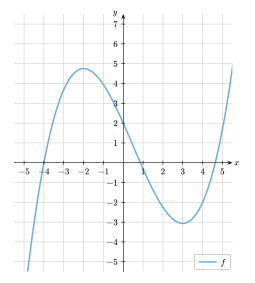

## Grafisches Differenzieren

<!-- **Was bedeutet das eigentlich?** \ -->
Mit Hilfe des grafischen Differenzierens lässt sich der Graph der Ableitungsfunktion konstruieren, ohne die Gleichung der Ausgangsfunktion oder der Ableitungsfunktion zu kennen oder zu verwenden.

<!-- Dabei geht man wie folgt vor:\ -->
Ausgangspunkt ist der Ansatz, dass die Ableitungsfunktion $f'$ die (Tangenten-)Steigung an jeder beliebigen Stelle von $f$ angibt.
Auf Basis der Eigenschaften von $f$ lassen sich dann konkrete Aussagen über den Graphen von $f'$ treffen:





| Funktion $f$ | Ableitungsfunktion $f'$ |
| --- | --- |
| Hochpunkt   (die Steigung ist erst positiv, dann negativ) | Nullstelle   (der Graph ist erst positiv, dann negativ) |
| Tiefpunkt   (die Steigung ist erst negativ, dann positiv) | Nullstelle   (der Graph ist erst negativ, dann positiv) |
| Wendepunkt | Hoch- oder Tiefpunkt   (hier ist die Steigung am größten oder kleinsten) |
| steigender Graph   (die Steigung ist positiv) | Graph oberhalb der $x$-Achse   ($f'(x) > 0$) |
| fallender Graph   (die Steigung ist negativ) | Graph unterhalb der $x$-Achse   ($f'(x) > 0$) |





Hat man auf diese Weise genügend Informationen über den Graph der Ableitungsfunktion gesammelt, so lässt sich dieser näherungsweise skizzieren.

## Grafisches Differenzieren an einem Beispiel



Gegegeben ist der Graph einer Funktion $f$.
Das Ziel ist es, den Graphen der Ableitungsfunktion $f'$ zu skizzieren, ohne die Funktionsgleichung von $f$ zu kennen.

*Abb. 1: Graph einer unbekannten Funktion - Graph der Ableitungsfunktion gesucht*
<!--  -->



Zunächst betrachtet man den Funktionsgraph und schaut, wo dieser Hoch- und Tiefpunkte besitzt. Hier befinden sich die Nullstellen der Ableitungsfunktion.



Im nächsten Schritt schaut man, an welchen Stellen der Funktionsgraph Wenedepunkte besitzt. An diesen Stellen hat der Graph der Ableitungsfunktion einen Hoch- oder Tiefpunkt.



Zu guter Letzt betrachten wir die Steigung des Graphen und können anhanddessen darauf schließen, in welchen Bereichen sich der Graph der Ableitungsfunktion oberhalb bzw. unterhalb der $x$-Achse befindet. Hierbei betrachtet man jeweils die Bereiche zwischen den einzelnen Nullstellen sowie die beiden äußeren Bereiche (sozusagen die Bereiche "drum herum").



Alles in allem entsteht auf diese Weise ein relativ genaues Bild des Graphen der Ableitung, welchen wir (vgl. <a href="#abb5">Abbildung 5</a>) nun skizzieren können.



## Übung macht den Meister

Teste dein Können, indem du mit Hilfe der nachfolgenden Learning-App den Funktionsgraphen (in blau dargestellt) ihre Ableitungen (in orange) zuordnest.


