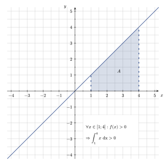
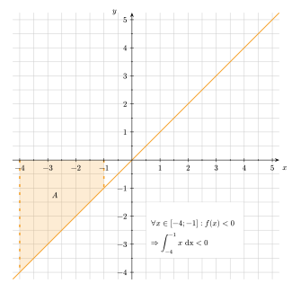
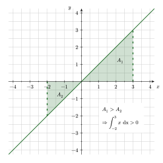
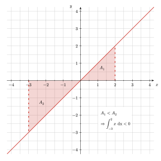
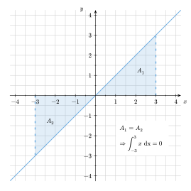

Wie man Stammfunktionen bildet, weißt du nun, da du dir dafür wesentliche Integrationsregeln angeeignet hast.
In diesem Abschnitt wollen wir mit Hilfe von Stammfunktionen eingeschlossene Flächen zwischen Graph und $x$-Achse berechnen.


Die bisherigen Abschnitte zusammengefasst, ergeben nun folgende Erkenntnis: \
Jede Integralfunktion einer stetigen Funktion $f$ ist eine **Stammfunktion von $f$**.

Aus $\quad \displaystyle F_a(x) = \int_a^x f(t) ~ dt \quad$ folgt $\quad F'(x)=f(x)$.

Kurz gesagt: Die Ableitung jeder Integralfunktion ergibt wieder die Integrandenfunktion (Ausgangsfunktion $f$).

Diese Aussage bezeichnet man auch als den **Hauptsatz der Differential- und Integralrechnung**.



Das **bestimmte Integral** bezeichnet die Summe der orientierten Flächeninhalte zwischen dem Graphen von $f$ und der $x$-Achse im Intervall $[a,b]$. Es wird also seitlich begrenzt durch zwei vertikale Geraden $x = a$ und $x = b$ (vgl. Abbildung 1).

Schreibweise:\
$\displaystyle \int_a^b f(x) ~ dx = \left[ F(x) \right]_a^b = F(b) − F(a)$





Beim bestimmten Integral von $f$ von $a$ bis $b$ handelt es sich um die **Summe der orientierten Flächeninhalte** der Teilflächen zwischen dem Graphen von $f$ und der $x$-Achse.

**Orientierung** meint hierbei, dass Flächen *oberhalb* ($+$) oder *unterhalb* ($-$) der $x$-Achse liegen können. Man geht also davon aus, dass ein Flächeninhalt mit negativem Vorzeichen ($-$) eine Fläche beschreibt, die unterhalb der $x$-Achse liegt. Ein Flächeninhalt mit positivem Vorzeichen ($+$) beschreibt wiederum eine Fläche, die oberhalb der $x$-Achse liegt.

Bei der Berechnung der Gesamtfläche wird eine positiv orientierte Fläche auch positiv gewertet, eine negativ orientierte Fläche wird hingegen negativ gewertet.

Geometrisch interpretiert handelt es sich beim bestimmten Integral daher um eine sogenannte **Flächenbilanz**. Das liegt daran, dass sich positiv und negativ orientierte Flächeninhalte auch gegenseitig aufheben können.


## Flächenbilanz


Ist $f$ eine im Intervall $[a; b]$ stetige Funktion, dann beschreibt das bestimmte Integral $\int_a^b f(x) ~ dx$ die **Flächenbilanz** der vom Graphen von $f$ und der $x$-Achse im Intervall $[a; b]$ eingeschlossenen Fläche.

- Sind alle Funktionswerte in diesem Bereich positiv, dann gilt: \
    $\displaystyle \forall x \in [a;b]: \quad f(x) \geq 0 \quad \Rightarrow \int_a^b f(x) ~ dx \geq 0$

<!-- 
 -->

*Abb. 1: Fläche oberhalb der $x$-Achse*

<!--  -->
<!-- 


 -->

- Sind alle Funktionswerte in diesem Bereich negativ, dann gilt: \
    $\displaystyle \forall x \in [a;b]: \quad f(x) \leq 0 \quad \Rightarrow \int_a^b f(x) ~ dx \leq 0$




*Abb. 2: Fläche unterhalb der $x$-Achse*

<!--  -->





 

Ist $f$ eine Funktion, die im Intervall $[a; b]$ *genau eine* Nullstelle besitzt, dann gibt es sowohl Funktionswerte, die positiv sind als auch Funktionswerte, die negativ sind. Das bedeutet auch, dass sich die gesamte eingeschlossene Fläche in zwei Teilflächen unterteilt, wobei eine Teilfläche oberhalb ($A_1 > 0$) und eine unterhalb ($A_2 < 0$) der $x$-Achse liegt.

Dann gilt: $\displaystyle \int_a^b f(x) ~ dx
\begin{cases}
    > 0, & \text{wenn  } & A_1 > A_2 \text{vgl. Abb. 3} \\\
    < 0, & \text{wenn  } & A_1 < A_2 \text{vgl. Abb. 4} \\\
    = 0, & \text{wenn  } & A_1 = A_2 \text{vgl. Abb. 5}.
\end{cases}$

<!-- 
    
        
        *Abb. 3: positive Flächenbilanz mit $A_1 > A_2$*
    
    
        
        *Abb. 4: negative Flächenbilanz mit $A_1 < A_2$*
    


    
        
        *Abb. 5: ausgeglichene Flächenbilanz mit $A_1 = A_2$*
    
    
    
 -->









Je nach Kontext kann es sein, dass man unterschiedliche Integrale ermitteln möchte. In einem bestimmten Kontext benötigt man womöglich eine Flächenbilanz, jedoch kann in einem anderen Sachkontext wiederum die Summe aller eingeschlossenen Flächen zwischen Graph und $x$-Achse gemeint sein. Man sollte hierbei also beachten, dass das bestimmte Integrals und die Summe der Teilflächen grundsätzlich ganz **unterschiedliche Aussagekraft** besitzen.

Das bedeutet, dass man also **strikt** zwischen $\int_a^b f(x) ~ dx$ und $\int_a^{x_0} f(x) ~ dx + \int_{x_0}^b f(x) ~ dx$ **unterscheiden** muss, wobei $x_0$ die Nullstelle darstellen soll, welche die Gesamtfläche in zwei Teilflächen unterteilt.



    Gegeben ist die Funktion $f(x)=x^3$. Gesucht ist die Summe der orientierten Flächeninhalte zwischen dem Graphen von $f$ und der $x$-Achse -- also das bestimmte Integral.




Da der Graph von $f$ an der Stelle $x=0$ eine Nullstelle besitzt, teilt diese die Gesamtfläche in zwei Teilflächen auf, wobei der linke Teil ($A_1$) unterhalb ($-$) und der rechte Teil ($A_2$) oberhalb ($+$) der $x$-Achse liegt.

Das linke Teilstück $A_1$ hat einen Flächeninhalt von $0,25$. $A_2$ besitzt einen Flächeninhalt von $4$. Entgegen einer ersten Vermutung ist jedoch unter dem Strich der Wert des bestimmten Integrals nicht $4,25$, sondern $3,75$. Dies liegt daran, dass sich das Teilstück $A_1$ unterhalb der $x$-Achse befindet und sich die beiden Teilflächen somit teilweise gegenseitig aufheben: \
$A_1 + A_2 = -0,25 + 4 = 3,75$.

## Ausblick

Du hast in den vorangegangenen Abschnitten gelernt, wie man Ober- und Untersummen berechnet, wie man Stammfunktionen bildet, um unbestimmte Integrale zu bestimmen und wie man mit Hilfe von bestimmten Integralen Flächen zwischen Graph und $x$-Achse bestimmt. Im nächsten Abschnitt befassen wir uns damit, [Flächen zwischen Graphen](/hbf2/4-integralrechnung/flächen-zwischen-graphen-bestimmen/) zu berechnen.
