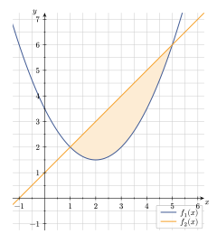

## Vorwort

Bislang haben wir uns mit dem Bilden von Stammfunktionen und dem Berechnen von bestimmten Integralen beschäftigt. Dabei handelt es sich um Flächen, die durch den Funktionsgraphen und die $x$-Achse eingeschlossen werden.

Es gibt aber auch Flächen, die von zwei Funktionsgraphen eingeschlossen werden. Mit diesen befassen wir uns in diesem Abschnitt.

## Flächen zwischen Graphen


Will man eine Fläche berechnen, die von zwei Funktionsgraphen $f$ und $g$ eingeschlossen wird, muss man zunächst die Ränder der Fläche bestimmen. Den oberen und unteren Rand kennen wir bereits, da die Fläche dort von den beiden Funktionsgraphen eingeschlossen wird. Den linken ($a$) und den rechten ($b$) Rand erhält man, indem man die **Schnittstellen der beiden Funktionsgraphen $f$ und $g$** bestimmt. Die $x$-Werte genügen hierfür.

**Schritt 1:** \
Die Schnittstellen der beiden Funktionsgraphen bestimmt man, indem man die beiden Funktionsgleichungen gleichsetzt und die entstandene Gleichung nach $x$ auflöst.

**Schritt 2:** \
Hat man auf diese Weise die Schnittstellen $a$ und $b$ bestimmt, setzt man diese als Unter- bzw. Obergrenze des gesuchten Integrals ein und berechnet das bestimmte Integral.

Eine Möglichkeit, um den Flächeninhalt der eingeschlossenen Fläche zu bestimmen, ist, zunächst für $f$ und $g$ die jeweils zwischen Funktionsgraph und $x$-Achse eingeschlossene Fläche im Intervall $[a;b]$ zu bestimmen und anschließend die beiden Flächeninhalte zu subtrahieren.

Zusammengefasst bedeutet das also:

1. Berechne die beiden Integrale $A_f = \int_a^b f(x) dx$ und $A_g = \int_a^b g(x) dx$ und
2. bilde anschließend die Differenz $A_f - A_g = A$.

Bildlich kann man sich das wie folgt vorstellen:

    <figure>
        
        
        <figcaption>
Abb. 1: Fläche unterhalb des Graphen von $f$
</figcaption>
    </figure>
    <figure>
        
        
        <figcaption>
Abb. 2: Fläche unterhalb des Graphen von $g$
</figcaption>
    </figure>

Die gesuchte Fläche $A$ erhält man als Differenz der beiden dargestellten Teilflächen $A_f$ und $A_g$.

Es gibt jedoch auch eine zweite Möglichkeit:

$\displaystyle
\begin{aligned}
A &= A_f - A_g \\\
&= \int_a^b f(x) ~ dx - \int_a^b g(x) ~ dx \\\
&= \int_a^b (f(x) - g(x)) ~ dx \\\
&= \int_a^b d(x) ~ dx
\end{aligned}$

mit $d(x)=f(x)-g(x)$.

Hierbei greift die **Summenregel** bezüglich des bestimmten Integrals, welche rückwärts gelesen besagt, dass man - anstatt mit $A_f$ und $A_g$ zwei Integrale zu bestimmen und anschließend zu subtrahieren - auch direkt die Differenz der beiden Funktionsterme $~ d(x) = f(x) - g(x)$ integrieren kann: \
$\displaystyle \int_a^b f(x) ~ dx ~ \pm \int_a^b g(x) ~ dx ~ = \int_a^b (f(x) \pm g(x)) ~ dx ~ = \int_a^b d(x) ~ dx$.



Der Graph der Funktion $f_1(x) = 0,5x^2 - 2x + 3,5$ wird vom Graphen der Funktion $f_2(x) = x + 1$ geschnitten. Gesucht ist die Fläche zwischen den beiden Funktionsgraphen.

Damit man die Fläche berechnen kann, die zwischen den beiden Graphen eingeschlossen wird, muss man zunächst die Grenzen kennen. Diese werden durch die Schnittpunkte der beiden Funktionsgraphen bestimmt:

*Abb. 3: Fläche zwischen zwei Graphen*
<!--  -->

Die Schnittpunkte lassen sich berechnen, indem man die beiden Funktionsgleichungen gleichsetzt:

$\displaystyle
\begin{aligned}
0,5x^2 - 2x + 3,5 &= x + 1 && \quad | - x - 1 \\\
0,5x^2 - 3x + 2,5 &= 0 && \quad | :0,5 \\\
x^2 - 6x + 5 &= 0 && \quad | \text{ p-q-Formel} \\\
\ldots && \\\
x_1 &= 1, \quad x_2 = 5
\end{aligned}$

Nun bildet man die Differenz der beiden Funktionen, um die Funktion zu erhalten, die die Fläche beschreibt:

$d(x) = f_1(x) - f_2(x) = 0,5x^2 - 2x + 3,5 - (x + 1) = 0,5x^2 - 3x + 2,5$

Und zum Schluss integriert man die Funktion $d(x)$ über die Grenzen der Schnittpunkte und bildet davon den Betrag, um die Fläche zu berechnen:

$\displaystyle
\begin{aligned}
A &= \int_1^5 d(x) dx \\\
&= \int_1^5 0,5x^2 - 3x + 2,5 dx \\\
&= \left[ 1/6 x^3 - 1,5 x^2 + 2,5x \right]_1^5
\end{aligned}$

Der gesuchte Flächeninhalt ist der Betrag der Differenz der Funktionswerte von $F(x)$ an den Grenzen $1$ und $5$:

$\displaystyle
\begin{aligned}
A &= \vert F(5) - F(1) \vert = \vert (1/6 \cdot 5^3 - 1,5 \cdot 5^2 + 2,5 \cdot 5) - (1/6 \cdot 1^3 - 1,5 \cdot 1^2 + 2,5 \cdot 1) \vert \\\
&= \quad \ldots \quad = \vert -25/6 - 7/6 \vert = \vert -32/6 \vert = 16/3 \approx 5,\overline{3} \text{ [FE]}
\end{aligned}$



## Übung macht den Meister



- Der Graph der Funktion $f_1(x) = 0,5(x - 2)^2 + 3,5$ wird vom Graphen der Funktion $f_2(x) = x + 3$ geschnitten. **Berechne** die Fläche zwischen den beiden Funktionsgraphen.
- Der Graph der Funktion $f_1(x) = x^3-4x^2+5x-3$ wird vom Graphen der Funktion $f_2(x) = 2x^2 -4x +1$ geschnitten. **Berechne** die Fläche zwischen den beiden Funktionsgraphen.
- Gegeben ist die Funktion $f(x) = 3x^2 + 18x + 24$. **Bestimme** die Fläche zwischen dem Funktionsgraphen, der $x$-Achse und der $y$-Achse.


